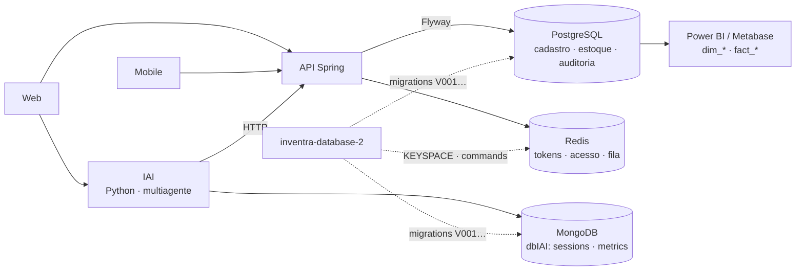
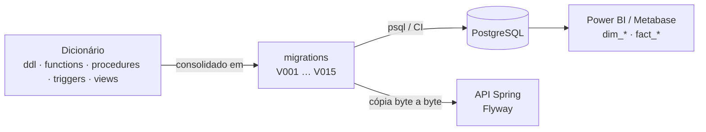
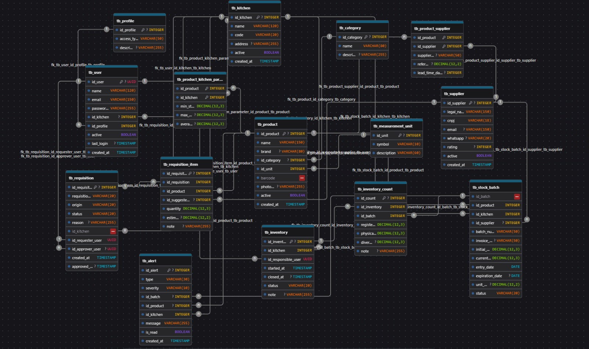

<div align="center">

# 📦 Inventra Database

**Bancos de dados do Inventra: gestão de estoque para cozinhas industriais.**


<br />
[](https://github.com/InventraTech/inventra-database-2/actions/workflows/migrations.yml)
[](https://github.com/InventraTech/inventra-database-2/actions/workflows/mongo.yml)
[](https://github.com/InventraTech/inventra-database-2/actions/workflows/redis.yml)


</div>

Bancos de dados do projeto interdisciplinar **Inventra**. Este repositório é a **fonte da verdade** de cada banco usado no projeto, com um diretório por tecnologia:

- **PostgreSQL:** tabelas, regras de negócio em SQL, auditoria automática, camada de consulta e Data Mart para BI.
- **MongoDB:** o contrato das coleções da IA.
- **Redis:** o catálogo de chaves e os comandos de cada operação da API.
- **Neo4j:** o levantamento de uso e a estrutura prevista.

Para navegar por tudo isso, abra o **[Database Workspace](database-workspace.html)**.

## Sumário

- [Database Workspace](#database-workspace)
- [Bancos](#bancos)
- [Arquitetura](#arquitetura)
- [PostgreSQL](#postgresql)
- [MongoDB](#mongodb)
- [Redis](#redis)
- [Neo4j](#neo4j)
- [Documentação](#documentação)
- [Estrutura do repositório](#estrutura-do-repositório)
- [Desenvolvimento](#desenvolvimento)
- [Roadmap](#roadmap)
- [Contribuidores](#contribuidores)

## Database Workspace

[`database-workspace.html`](database-workspace.html) é a documentação navegável de todos os bancos, num único arquivo que abre direto no navegador (sem servidor nem instalação). No `main` ele é publicado no GitHub Pages por [`pages.yml`](.github/workflows/pages.yml):

- **PostgreSQL:** cada tabela com colunas, tipos, chaves, descrição, regra de negócio, nível de acesso e dado pessoal (LGPD) do catálogo; relacionamentos, índices, triggers, quem usa e o DDL. Diagrama ER interativo, dicionário de dados exportável em CSV, views, functions, procedures, triggers, índices, constraints e as migrations em ordem.
- **MongoDB, Redis e Neo4j:** contrato das coleções com documento de exemplo, keyspace com os comandos de cada operação e o levantamento do grafo.
- **Repositório:** todos os scripts com realce de sintaxe e links para os objetos, os documentos `.md` renderizados e o histórico de commits.
- **Busca global** (`Ctrl K` ou `/`) por tabela, coluna, objeto, chave, arquivo e trecho de código; tema claro e escuro.

Os dados vêm do schema real: o script lê o catálogo de um PostgreSQL com as migrations aplicadas e os arquivos versionados. Depois de mudar o banco, regenere:

```bash
export PGHOST=localhost PGUSER=postgres PGPASSWORD=postgres PGDATABASE=inventra_db
for f in postgre/migrations/V*.sql; do psql -v ON_ERROR_STOP=1 --single-transaction -q -f "$f"; done
python scripts/workspace/build.py
```

O `build.py` só reescreve o bloco de dados do HTML; a interface é o próprio arquivo. A introspecção está em [`scripts/workspace/introspect.sql`](scripts/workspace/introspect.sql).

## Bancos

| Banco | Pasta | Usado por | Papel | CI |
|-------|-------|-----------|-------|----|
| **PostgreSQL 16** | [`postgre/`](postgre) | API Spring | Fonte da verdade do cadastro, estoque, requisições, inventário, alertas e auditoria | [`migrations.yml`](.github/workflows/migrations.yml) |
| **MongoDB 8** | [`mongo/`](mongo) | IA (IAI) | Banco `dbIAI`: conversas do chat e métricas de custo/latência por requisição | [`mongo.yml`](.github/workflows/mongo.yml) |
| **Redis 7** | [`redis/`](redis) | API Spring | Refresh tokens, pedidos de acesso à cozinha e fila de cadastro por código de barras | [`redis.yml`](.github/workflows/redis.yml) |
| **Neo4j** | [`neo4j/`](neo4j) | nenhum serviço | Ainda não usado | sem CI |

| Serviço | Repositório | Bancos |
|---------|-------------|--------|
| API Spring | [`inventra-development-spring-redis-neo4j-2`](https://github.com/InventraTech/inventra-development-spring-redis-neo4j-2) | PostgreSQL (Flyway) e Redis; Neo4j só no nome |
| IA (IAI) | [`inventra-artificial-intelligence-2`](https://github.com/InventraTech/inventra-artificial-intelligence-2) | MongoDB; o estoque é consultado pela API, não direto no PostgreSQL |
| API Spring MongoDB | [`inventra-development-mongo-2`](https://github.com/InventraTech/inventra-development-mongo-2) | Prevista; o repositório ainda não tem código |

O PostgreSQL é o único dono dos dados de negócio. MongoDB e Redis guardam `id_user` e `id_kitchen` do PostgreSQL como referência, sem chave estrangeira; por isso o contrato de cada um fica documentado aqui, junto do schema relacional.

## Arquitetura



O que vai para cada banco a partir deste repositório:

| Banco | Esteira | Quem aplica |
|-------|---------|-------------|
| PostgreSQL | `postgre/migrations/V*.sql`, consolidadas a partir do dicionário (`ddl/`, `functions/`, `procedures/`, `triggers/`, `views/`) | A API copia as migrations byte a byte e o Flyway aplica |
| MongoDB | `mongo/migrations/V*.js`, a partir de `schemas/` e `indexes/` | `mongosh`; a IAI também cria os mesmos índices no startup |
| Redis | Não há schema. `redis/docs/KEYSPACE.md` e `redis/commands/` descrevem o que a API grava | A própria API |

## PostgreSQL

Banco relacional do ERP. Detalhes, convenções e decisões de design em [`ARCHITECTURE.md`](postgre/docs/ARCHITECTURE.md).

| | |
|---|---|
| **Domínio** | Lotes de estoque, requisições, inventário, fornecedores e alertas de vencimento |
| **Modelo** | 18 tabelas de negócio + 8 de log (`tb_log_base` e 7 filhas por herança) + 4 de governança; 3FN demonstrada tabela a tabela |
| **Regras no banco** | 6 functions + 7 procedures + 6 triggers de negócio |
| **Auditoria** | Trigger `AFTER INSERT/UPDATE/DELETE` grava antes/depois (JSON) em 7 tabelas `tb_log_*` |
| **Consulta** | 15+ views operacionais, 3 views analíticas (CTE + Window Functions), star schema virtual (4 `dim_*`, 3 `fact_*`) |
| **Governança** | Catálogo de dados: descrição, regra de negócio e nível de acesso de cada tabela e coluna |
| **Backup** | Backup gerenciado (Aiven) + `pg_dump` com restore testado no CI + recuperação de linha pela auditoria |
| **Monitoramento** | DAU registrado pelo próprio banco a cada login (trigger em `tb_user.last_login`), com `vw_dau` e `vw_dau_by_kitchen` |
| **Entrega** | Migrations idempotentes `V001`–`V015`, com rollback e validação no CI |

### Dicionário e migrations

O projeto separa o **dicionário** (código de leitura, um arquivo por assunto) da **esteira de migrations** (o que de fato roda no banco, com guardas de idempotência).



| Migration | Conteúdo |
|-----------|----------|
| `V001__init_database.sql` | Tabelas, FKs, índices e checks |
| `V002__business_rules.sql` | Functions, procedures e triggers de negócio |
| `V003__audit_logs.sql` | Tabelas, índices, functions e triggers de log |
| `V004__views.sql` | Views operacionais + Data Mart |
| `V005__etl_analytics.sql` | Views analíticas (CTEs + Window Functions) |
| `V006__google_login_and_kitchen_location.sql` | Login Google (`firebase_uid`, senha opcional) e localização da cozinha |
| `V007__stock_movements.sql` | Histórico de movimentações (`tb_stock_movement`) gravado pelas procedures de entrada e baixa |
| `V008__alert_recipients_and_reads.sql` | Destinatário do alerta, leitura por pessoa (`tb_alert_read`) e aviso antes de vencer |
| `V009__requisition_draft.sql` | Status `DRAFT` e estorno do estoque ao cancelar requisição aprovada |
| `V010__data_catalog.sql` | Catálogo de dados (`tb_catalog_*`), sincronização com o schema e views `vw_data_catalog*` |
| `V011__backup_and_recovery.sql` | Histórico de backup (`tb_backup_history`), recuperação pela auditoria e `vw_backup_status` |
| `V012__normalization_integrity.sql` | Protege as redundâncias controladas: `divergence` sempre recalculada e alerta com produto e cozinha do lote |
| `V013__daily_active_users.sql` | Registro automático de acessos (`tb_user_daily_access`) e DAU (`vw_dau`, `vw_dau_by_kitchen`) |
| `V014__ui_click_counter.sql` | Contador de cliques: uma linha, uma coluna por coisa clicável do web e do mobile (`tb_ui_click_counter`), e `vw_ui_click_ranking` |
| `V015__user_profile_photo.sql` | Foto de perfil do usuário (`tb_user.photo_url`, URL do Cloudinary) |

> [!WARNING]
> A API tem uma `V010__product_registration_event.sql` própria, que adiciona `tb_product.registration_event_id` para a fila Redis. Essa coluna ainda não está neste repositório, e o número `V010` aqui é o catálogo de dados. As migrations `V001`–`V009` são idênticas nos dois repositórios.

### Modelo de dados



| Grupo | Tabelas |
|-------|---------|
| **Cadastros base** | `tb_user`, `tb_profile`, `tb_kitchen`, `tb_product`, `tb_category`, `tb_measurement_unit`, `tb_supplier` |
| **Relacionamentos** | `tb_product_supplier`, `tb_product_kitchen_parameter` |
| **Movimentações** | `tb_stock_batch`, `tb_requisition`, `tb_requisition_item`, `tb_inventory`, `tb_inventory_count`, `tb_stock_movement` |
| **Eventos** | `tb_alert`, `tb_alert_read`, `tb_user_daily_access`, `tb_ui_click_counter` |
| **Auditoria** | `tb_log_base` + `tb_log_user`, `tb_log_product`, `tb_log_supplier`, `tb_log_stock_batch`, `tb_log_requisition`, `tb_log_inventory`, `tb_log_alert` |
| **Governança** | `tb_catalog_access_level`, `tb_catalog_table`, `tb_catalog_column`, `tb_backup_history` |

Outras versões do modelo (V1, V2 e auditoria) estão em [`docs/modeling`](postgre/docs/modeling). A normalização, as dependências funcionais e as cardinalidades de cada relacionamento estão em [`NORMALIZATION.md`](postgre/docs/normalization/NORMALIZATION.md).

### Quick start

**Requisitos:** PostgreSQL 14+ e `psql` (testado no CI com PostgreSQL 16).

```bash
git clone https://github.com/InventraTech/inventra-database-2.git
cd inventra-database-2/postgre

for f in migrations/V*.sql; do
  psql -v ON_ERROR_STOP=1 --single-transaction -U usuario -d inventra_db -f "$f"
done
```

As migrations são idempotentes: reexecutar em um banco que já as recebeu não gera erro.

**Rollback completo:**

```bash
psql -v ON_ERROR_STOP=1 --single-transaction -U usuario -d inventra_db -f migrations/rollback/drop_everything.sql
```

Para reverter apenas uma camada, use o `rollback/` da respectiva pasta de dicionário (ex: `ddl/tables/rollback/drop_tables.sql`).

**Massa de dados fictícia (opcional):**

```bash
cp ../.env.example ../.env          # ajuste as credenciais
pip install -r seeds/requirements.txt
jupyter notebook seeds/seed.ipynb
```

## MongoDB

Banco de documentos da IA (`dbIAI`). Guarda o log das conversas e as métricas de cada requisição; nada do estoque. Modelo completo em [`MONGO_MODEL.md`](mongo/docs/MONGO_MODEL.md).

| Coleção | Conteúdo | Escrita por | Índices |
|---------|----------|-------------|---------|
| `sessions` | Uma conversa: `session_id`, `user_id`, `summary` (vazio = ativa) e `messages[]` com `role` `human`, `iai` ou `judge` | `memory.py` | `session_id_1`, `user_id_1_started_at_-1` |
| `metrics` | Uma requisição de `/chat`: latência por nó do grafo, chamadas de LLM (tokens e custo), status e se foi resolvida | `metrics.py` | `timestamp_-1` |
| `schema_migrations` | Migrations aplicadas por esta esteira (`_id = 'V001'`) | `mongo/migrations` | |

| | |
|---|---|
| **Por que documento** | A conversa é lida e escrita inteira, e o formato das mensagens muda com o grafo de agentes; um array embutido evita join e migração a cada mudança |
| **Contrato** | `$jsonSchema` em [`mongo/schemas/`](mongo/schemas), com `validationLevel: moderate` e `validationAction: warn`: documento fora do contrato é gravado e gera aviso no log, para não derrubar o chat |
| **Privacidade** | `content` já chega anonimizado pela IAI (e-mail, CPF, RG e telefone viram tokens); `user_id` é o único identificador pessoal |
| **Retenção** | Sem TTL. Uma retenção de `metrics` (ex.: 90 dias) fica para uma migration futura |
| **Entrega** | `V001__init_dbiai.js` idempotente, com rollback e validação no CI |

### Quick start

**Requisitos:** MongoDB 7+ e `mongosh` (testado no CI com MongoDB 8).

```bash
cd mongo
for f in migrations/V*.js; do mongosh "$MONGO_CONNECTION" --file "$f"; done
```

`MONGO_DB` troca o banco alvo (padrão `dbIAI`).

**Rollback completo** (apaga as conversas e as métricas):

```bash
mongosh "$MONGO_CONNECTION" --file migrations/rollback/drop_everything.js
```

**Massa de dados fictícia (opcional):** `pip install -r seeds/requirements.txt` e `seeds/seed.ipynb`. O seed grava só no MongoDB. Se as variáveis `DB_*` estiverem no `.env`, ele lê os `id_user` de `tb_user` para usar usuários reais; sem elas, gera UUIDs fictícios.

## Redis

Estado operacional da API, sem schema. O contrato de cada chave está em [`KEYSPACE.md`](redis/docs/KEYSPACE.md).

| Uso | Chaves | TTL |
|-----|--------|-----|
| Refresh tokens (rotação e revogação por família) | `rt:{hash}`, `rt:fam:{familyId}` | 30 dias |
| Pedidos de acesso à cozinha | `kar:{id}`, `kar:user:{userId}`, `kar:user:{userId}:kitchens`, `kar:kitchen:{kitchenId}` | 7 dias enquanto pendente; decidido fica como histórico |
| Fila de cadastro por código de barras (FIFO, DLQ) | `inventra:product-registration:*` (`ready`, `job:{eventId}`, `pending`, `sequence`, `consumer-lock`, `errors`) | Pendentes sem TTL; resultado e DLQ 7 dias |

| | |
|---|---|
| **Serviço** | Aiven for Valkey/Redis, standalone, TLS |
| **Comandos** | [`redis/commands/`](redis/commands): um arquivo `.redis` por operação da API, com os comandos passo a passo e comentados. São de leitura; a API executa as operações condicionais de uma vez só, de forma atômica |
| **Configuração** | [`redis.conf`](redis/config/redis.conf) de referência: `maxmemory-policy noeviction` (pendentes e histórico não têm TTL e não podem ser despejados) e AOF |
| **Backup** | Não é fonte da verdade. Perder o Redis derruba sessões, pedidos de acesso pendentes e jobs ainda não processados; o cadastro continua no PostgreSQL |
| **Fora do Redis** | Os limites de tentativa de login e de busca de cozinha ficam em memória da instância da API |

### Quick start

Redis local com a configuração de referência:

```bash
docker run -d -p 6379:6379 -v "$PWD/redis/config/redis.conf:/usr/local/etc/redis/redis.conf" redis:7 redis-server /usr/local/etc/redis/redis.conf
```

Para inspecionar, use `SCAN` com padrão (`redis-cli --scan --pattern 'kar:kitchen:*'`), nunca `KEYS` em produção.

## Neo4j

**Não usado.** Nenhum serviço conecta ao Neo4j hoje: o repositório da API cita Neo4j no nome, mas não tem dependência, configuração nem código. O levantamento e a estrutura prevista para quando o grafo entrar (constraints, índices, migrations `.cypher`, seed e testes) estão em [`neo4j/README.md`](neo4j/README.md).

## Documentação

| Banco | Documento | Assunto |
|-------|-----------|---------|
| Todos | [`database-workspace.html`](database-workspace.html) | Documentação navegável e pesquisável de todos os bancos (veja [Database Workspace](#database-workspace)) |
| PostgreSQL | [`ARCHITECTURE.md`](postgre/docs/ARCHITECTURE.md) | Dicionário vs. migrations, convenções, CI, herança das tabelas de log |
| PostgreSQL | [`NORMALIZATION.md`](postgre/docs/normalization/NORMALIZATION.md) | Demonstração da 3FN (e FNBC, 4FN, 5FN), redundâncias controladas, PKs, FKs e cardinalidades |
| PostgreSQL | [`BUSINESS_RULES.md`](postgre/docs/BUSINESS_RULES.md) | Functions, procedures, triggers de negócio e de auditoria |
| PostgreSQL | [`VIEWS_AND_DATAMART.md`](postgre/docs/VIEWS_AND_DATAMART.md) | Views operacionais, star schema e views analíticas |
| PostgreSQL | [`DATA_CATALOG.md`](postgre/docs/DATA_CATALOG.md) | Catálogo de dados: níveis de acesso, views de consulta e sincronização |
| PostgreSQL | [`BACKUP_AND_RECOVERY.md`](postgre/docs/BACKUP_AND_RECOVERY.md) | Política de backup, runbook de recuperação por tipo de falha, monitoramento |
| PostgreSQL | [`MONITORING.md`](postgre/docs/MONITORING.md) | DAU: registro automático de acessos, views e otimização do MAU |
| PostgreSQL | [`EXPLAIN_ANALYZE.md`](postgre/docs/query_optimization/EXPLAIN_ANALYZE.md) | Otimização de consultas: planos antes/depois dos 4 índices criados |
| MongoDB | [`MONGO_MODEL.md`](mongo/docs/MONGO_MODEL.md) | Coleções, contrato `$jsonSchema`, índices, validação, retenção e esteira |
| Redis | [`KEYSPACE.md`](redis/docs/KEYSPACE.md) | Cada chave (tipo, campos, TTL, dono), comandos por operação e operação do serviço |
| Neo4j | [`README.md`](neo4j/README.md) | Levantamento (não usado) e estrutura prevista |

## Estrutura do repositório

```text
postgre/
├── ddl/             # tables, constraints, indexes, logs, catalog, backup e monitoring
├── functions/       # funções de negócio, de log e de recuperação
├── procedures/      # rotinas chamadas via CALL (negócio, catálogo e recuperação)
├── triggers/        # gatilhos de negócio e de auditoria
├── views/           # vw_*  ·  datamart/ (dim_*, fact_*)  ·  analytics/  ·  catalog/  ·  backup/  ·  monitoring/
│                    #   (cada pasta tem subpasta rollback/)
├── migrations/      # V001–V015 + rollback/drop_everything.sql
├── backup/          # backup.sh e restore.sh (pg_dump); dumps/ fica fora do git
├── seeds/           # seed.ipynb + requirements.txt
├── tests/           # migrations (idempotência + rollback), integridade, DAU, backup/restore e dicionário × migrations
└── docs/            # arquitetura, regras, views, modelagem, otimização
mongo/
├── schemas/         # contrato de cada coleção em JSON Schema + rollback/remove_validators.js
├── indexes/         # create_indexes.js + rollback/
├── migrations/      # V001__init_dbiai.js + rollback/drop_everything.js
├── seeds/           # seed.ipynb + requirements.txt
├── tests/           # migrations (idempotência + rollback), contrato, índices e dicionário × migrations
└── docs/            # MONGO_MODEL.md
redis/
├── commands/        # comandos de cada operação (.redis): auth/, kitchen-access/, product-queue/
├── config/          # redis.conf de referência (noeviction, AOF)
├── tests/           # redis.conf aplicado num redis:7 e KEYSPACE.md × commands/
└── docs/            # KEYSPACE.md
neo4j/               # README com o levantamento; ainda sem uso
scripts/workspace/   # build.py + introspect.sql: geram os dados do database-workspace.html
database-workspace.html  # documentação navegável de todos os bancos
.github/workflows/   # CI: migrations (PostgreSQL), mongo e redis
.env.example         # variáveis de conexão usadas pelos seeds, backups e testes
```

## Desenvolvimento

### PostgreSQL

1. A mudança nasce na pasta de dicionário correspondente **e** em uma **nova** migration, com o próximo número da sequência (hoje, `V015`). Migration já aplicada não se edita. Arquivo novo no dicionário entra também na lista `DICTIONARY` de `postgre/tests/check_dictionary_sync.sh`, que define a ordem de execução do dicionário.
2. Valide localmente com os mesmos scripts do CI, nesta ordem (todos usam as mesmas variáveis):

   ```bash
   export PGHOST=localhost PGUSER=postgres PGPASSWORD=postgres PGDATABASE=inventra_db
   bash postgre/tests/check_migrations.sh
   psql -X -q -v ON_ERROR_STOP=1 -f postgre/tests/check_normalization_integrity.sql
   psql -X -q -v ON_ERROR_STOP=1 -f postgre/tests/check_daily_access.sql
   psql -X -q -v ON_ERROR_STOP=1 -f postgre/tests/check_ui_click_counter.sql
   bash postgre/tests/check_backup_restore.sh
   bash postgre/tests/check_dictionary_sync.sh
   ```

   | Script | O que garante |
   |--------|---------------|
   | `check_migrations.sh` | Aplica as migrations, reaplica (idempotência), faz rollback completo e reaplica do zero |
   | `check_normalization_integrity.sql` | As triggers que protegem as redundâncias controladas (`divergence` e alerta × lote) |
   | `check_daily_access.sql` | O registro de acessos pela trigger e os números de `vw_dau` e `vw_dau_by_kitchen` |
   | `check_ui_click_counter.sql` | A linha única do contador de cliques, a soma por coluna, `vw_ui_click_ranking` e o catálogo das colunas |
   | `check_backup_restore.sh` | Recuperação pela auditoria, backup, restore em banco novo e contagens iguais |
   | `check_dictionary_sync.sh` | O dicionário gera exatamente o mesmo schema e catálogo que as migrations |
3. O CI roda esses seis testes em cada push/PR que toque `postgre/`.
4. A API copia `V001`+ byte a byte para o Flyway; nunca edite migration direto lá.

> `RAISE EXCEPTION` das functions e procedures fica em português de propósito: a API repassa a mensagem ao cliente nas respostas 409.

### MongoDB

1. Mudança de contrato entra em `mongo/schemas/` (e `mongo/indexes/`, se for o caso) **e** numa nova `mongo/migrations/V00N__*.js` idempotente, registrada em `schema_migrations`. Índice novo usa o nome padrão do driver (`campo_ordem`), porque a IAI cria os mesmos índices no startup.
2. Valide localmente num MongoDB descartável, com o mesmo script do CI:

   ```bash
   docker run -d --name inventra-mongo-test -v "$PWD:/repo" mongo:8
   docker exec inventra-mongo-test bash /repo/mongo/tests/check_migrations.sh
   ```

   O script aplica as migrations duas vezes, confere validadores e índices, compara `schemas/` e `indexes/` com o que as migrations criaram, faz rollback e reaplica. Usa o banco `dbIAI_ci`: nunca rodar contra o banco real.
3. O CI roda esse teste em cada push/PR que toque `mongo/`.

### Redis

1. Chave nova, campo novo ou TTL diferente na API entra no [`KEYSPACE.md`](redis/docs/KEYSPACE.md) e no arquivo de `redis/commands/` da operação, no mesmo PR da API.
2. Mudança de configuração do serviço (eviction, persistência) entra em `redis/config/redis.conf` e precisa ser aplicada também no console da Aiven.
3. Valide localmente com os mesmos scripts do CI (o segundo precisa de docker):

   ```bash
   bash redis/tests/check_keyspace_sync.sh   # KEYSPACE.md e commands/ descrevem as mesmas chaves
   bash redis/tests/check_config.sh          # o redis.conf sobe num redis:7 e cada diretiva é aplicada
   ```
4. O CI roda esses dois testes em cada push/PR que toque `redis/`.

## Roadmap

- [x] Functions, procedures e triggers de negócio
- [x] Auditoria com herança de tabelas de log
- [x] Views operacionais, Data Mart e views analíticas
- [x] Seed inicial (`seeds/seed.ipynb`)
- [x] Teste automatizado de idempotência/rollback no CI
- [ ] Testes de integridade e performance
- [x] Catálogo de dados no banco (`tb_catalog_*` + `vw_data_catalog`)
- [x] Backup e recuperação documentados e testados no CI
- [x] Monitoramento de uso (DAU) registrado pelo banco
- [x] Contrato do MongoDB da IA (`$jsonSchema`, índices, seed e CI)
- [x] Catálogo de chaves e comandos por operação do Redis
- [ ] `tb_product.registration_event_id` da fila Redis no `postgre/` (hoje só na `V010` da API)
- [ ] Modelo de grafo no Neo4j
- [ ] Ambiente de homologação

## Contribuidores

| Nome | Papel |
|------|-------|
| **@dvarakaki** | Desenvolvedor de Banco de Dados |
| **@joohnyxxz** | Desenvolvedor de Banco de Dados |

## Licença

[MIT](LICENSE) · Organização: [InventraTech](https://github.com/InventraTech)
