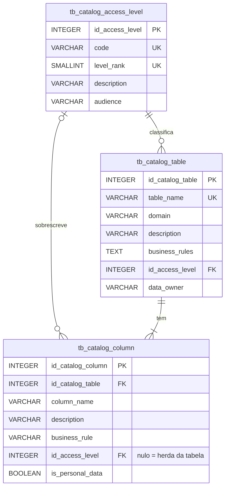

# Catálogo de Dados

Tabela técnica de metadados que descreve cada tabela e coluna do banco: para que serve, regra de negócio e nível de acesso. Criada em `migrations/V010__data_catalog.sql` e consultada pelas views `vw_data_catalog` e `vw_data_catalog_table`.

## Modelo



| Tabela | Cardinalidade | Papel |
|--------|---------------|-------|
| `tb_catalog_access_level` | 1:N com tabela e coluna | Os 4 níveis de acesso e quem pode ler cada um |
| `tb_catalog_table` | 1:N com coluna | Uma linha por tabela: domínio, descrição, regras, nível de acesso e área dona |
| `tb_catalog_column` | N:1 com tabela | Uma linha por coluna: descrição, regra, nível próprio (opcional) e marcação LGPD |

**O que o catálogo não guarda:** tipo, nulidade, PK e FK da coluna. Isso já existe no `pg_catalog` do PostgreSQL, e as views lêem de lá na hora. Guardar uma cópia quebraria a 3FN, e a cópia ficaria desatualizada na primeira `ALTER TABLE`. Pelo mesmo motivo, "a tabela contém dado pessoal" é calculado a partir das colunas e não fica gravado.

## Níveis de acesso

| `code` | `level_rank` | O que é | Quem lê |
|--------|--------------|---------|---------|
| `PUBLIC` | 1 | Dado de referência, sem risco se exposto | Qualquer usuário autenticado e o BI |
| `INTERNAL` | 2 | Dado operacional da cozinha | Usuários da própria cozinha (filtro da API); BI só agregado |
| `RESTRICTED` | 3 | Dado comercial (preço, fornecedor) ou pessoal (LGPD) | Supervisor e comprador; BI só agregado ou anonimizado |
| `CONFIDENTIAL` | 4 | Credencial, identificador de autenticação, trilha de auditoria | Só o DBA e a conta de serviço da API |

A coluna herda o nível da tabela, a não ser que tenha um nível próprio. Exemplos de nível próprio: `tb_user` é `RESTRICTED`, mas `password_hash` e `firebase_uid` são `CONFIDENTIAL`. `tb_stock_batch` é `INTERNAL`, mas `unit_price` é `RESTRICTED`.

Os níveis são **classificação documentada**: o banco não aplica `GRANT` com base neles. Quem aplica o controle é a API, que filtra por perfil e por cozinha.

## Domínios

| `domain` | Tabelas |
|----------|---------|
| `MASTER_DATA` | `tb_user`, `tb_profile`, `tb_kitchen`, `tb_product`, `tb_category`, `tb_measurement_unit`, `tb_supplier` |
| `RELATIONSHIP` | `tb_product_supplier`, `tb_product_kitchen_parameter` |
| `TRANSACTION` | `tb_stock_batch`, `tb_requisition`, `tb_requisition_item`, `tb_inventory`, `tb_inventory_count`, `tb_stock_movement` |
| `EVENT` | `tb_alert`, `tb_alert_read`, `tb_user_daily_access` |
| `AUDIT` | `tb_log_base` e as 7 `tb_log_*` |
| `GOVERNANCE` | as 3 tabelas do próprio catálogo |
| `UNCLASSIFIED` | tabela nova que a sincronização encontrou e ainda não foi classificada |

## Views

**`vw_data_catalog`**: uma linha por coluna. Junta o metadado de negócio do catálogo com o técnico do `pg_catalog`.

| Coluna | Origem |
|--------|--------|
| `table_name`, `domain`, `table_description` | `tb_catalog_table` |
| `column_position`, `data_type`, `is_nullable` | `pg_attribute` |
| `is_primary_key`, `references_to` | `pg_constraint` (ex: `tb_kitchen.id_kitchen`) |
| `column_description`, `business_rule`, `is_personal_data` | `tb_catalog_column` |
| `access_level`, `access_level_rank`, `inherits_table_access` | nível da coluna ou, se nulo, o da tabela |
| `is_documented`, `exists_in_schema` | qualidade do catálogo |

**`vw_data_catalog_table`**: uma linha por tabela, com nível de acesso e público (`audience`), área dona, tabela-mãe (`inherits_from`), linhas estimadas, total de colunas, `% documentado` e se a tabela contém dado pessoal.

```sql
-- dicionário de uma tabela
SELECT column_name, data_type, is_nullable, is_primary_key, references_to,
       column_description, business_rule, access_level
FROM vw_data_catalog
WHERE table_name = 'tb_stock_batch'
ORDER BY column_position;

-- inventário LGPD: onde há dado pessoal
SELECT table_name, column_name, access_level
FROM vw_data_catalog
WHERE is_personal_data
ORDER BY access_level_rank DESC, table_name;

-- o que nunca pode ir para o BI
SELECT table_name, column_name
FROM vw_data_catalog
WHERE access_level = 'CONFIDENTIAL';

-- cobertura da documentação
SELECT table_name, domain, access_level, documentation_pct, contains_personal_data
FROM vw_data_catalog_table
ORDER BY documentation_pct, table_name;
```

## Sincronização com o schema

`sp_sync_data_catalog(p_prune BOOLEAN DEFAULT false)` compara o catálogo com o schema atual:

- toda tabela `tb_*` que ainda não está no catálogo entra como `UNCLASSIFIED`/`INTERNAL`, sem descrição;
- toda coluna própria que ainda não está no catálogo entra sem descrição;
- com `p_prune = true`, remove do catálogo as tabelas e colunas que não existem mais no schema; sem ele, elas só aparecem com `exists_in_schema = false`;
- termina com um `NOTICE` que resume o que mudou e quantas colunas estão sem descrição.

```sql
CALL sp_sync_data_catalog();       -- só inclui o que falta
CALL sp_sync_data_catalog(true);   -- inclui e remove o que saiu do schema
```

A `V010` chama a procedure no final, e as migrations seguintes também (a `V011` acrescenta `tb_backup_history`, e a `V013`, `tb_user_daily_access`). Com a carga atual, ela inclui 0 tabelas e encontra 0 colunas sem descrição, o que prova que o catálogo cobre o schema inteiro: 30 tabelas e 175 colunas.

Só entram tabelas com prefixo `tb_`, para ficarem de fora tabelas de ferramenta, como a `flyway_schema_history` que o Flyway cria no banco da API.

## Herança nas tabelas de log

As colunas comuns de auditoria (`id_log`, `operation`, `db_user`, `operation_date`, `previous_data`, `new_data`) são documentadas **uma vez**, em `tb_log_base`. Cada filha `tb_log_*` documenta só a própria coluna, e `vw_data_catalog_table.inherits_from` mostra de quem ela herda. A sincronização segue a mesma regra e ignora colunas herdadas (`pg_attribute.attislocal`).

## Manutenção

Toda migration que cria tabela ou coluna deve incluir, na mesma migration, o `INSERT ... ON CONFLICT DO UPDATE` com os metadados dela, seguindo o padrão da `V010`. Se faltar, a próxima chamada de `sp_sync_data_catalog()` inclui a tabela ou coluna sem descrição, e ela aparece com `is_documented = false`.

| Arquivo | Conteúdo |
|---------|----------|
| `ddl/catalog/create_catalog_tables.sql` | Tabelas, FKs, checks e índices |
| `ddl/catalog/load_catalog_metadata.sql` | Carga dos níveis e dos metadados de tabelas e colunas |
| `procedures/create_catalog_procedures.sql` | `sp_sync_data_catalog` |
| `views/catalog/create_catalog_views.sql` | `vw_data_catalog` e `vw_data_catalog_table` |
