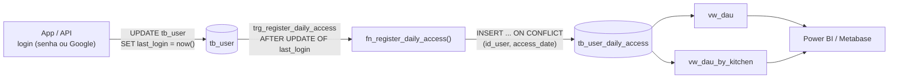

# Monitoramento de Uso (DAU)

Registro automático de acessos direto no PostgreSQL, para medir o **DAU (Daily Active Users)**: quantos usuários **distintos** usaram o sistema em cada dia. Criado em `migrations/V013__daily_active_users.sql`.

Exemplo: se no dia 14 a mesma pessoa entrou 3 vezes e outra entrou 1 vez, o DAU do dia é **2** (pessoas) e o total de acessos é **4**.

## Como o acesso é registrado



A API já grava `tb_user.last_login` a cada login (`UserService.registerLogin`). O banco aproveita essa escrita: a trigger `trg_register_daily_access` dispara quando `last_login` muda e a function `fn_register_daily_access` registra o acesso. **Ninguém precisa lembrar de gravar log de acesso**: qualquer caminho que atualize `last_login` é contado.

| Situação | O que acontece em `tb_user_daily_access` |
|----------|------------------------------------------|
| Primeiro login do usuário no dia | Nova linha com `access_count = 1` |
| Outro login no mesmo dia | Mesma linha: `access_count + 1` e `last_access_time` atualizada |
| Login no dia seguinte | Nova linha |
| `UPDATE` em outra coluna de `tb_user` (nome, perfil, cozinha) | Nada (a trigger só olha `last_login`) |
| `last_login` apagado ou voltando no tempo (ex.: `sp_restore_from_audit`) | Nada: não é um login |
| Usuário apagado | O histórico dele é apagado junto (`ON DELETE CASCADE`, dado pessoal) |

### Limitação conhecida: sessão renovada por refresh token

Na API, o access token dura 30 minutos e o refresh token, 30 dias. O `AuthService.refresh()` **não** chama `registerLogin`, então quem abre o app todo dia sem fazer login de novo não atualiza `last_login` e fica fora do DAU. A correção é na API, uma linha: chamar `userUseCase.registerLogin(user.getId())` também no `refresh()`. Vários refreshes no mesmo dia não inflam o DAU, só somam em `access_count`.

## Tabela `tb_user_daily_access`

| Coluna | Tipo | Regra |
|--------|------|-------|
| `id_user` | `UUID` | PK (parte); FK para `tb_user`, `ON DELETE CASCADE` |
| `access_date` | `DATE` | PK (parte) |
| `first_access_time` | `TIME` | Hora do primeiro acesso do dia |
| `last_access_time` | `TIME` | Hora do último acesso do dia; nunca antes do primeiro (`ck_useraccess_period`) |
| `access_count` | `INTEGER` | Logins no dia; maior que zero (`ck_useraccess_count`) |

**Uma linha por usuário por dia**, e não uma por login. Assim a tabela cresce no máximo `usuários × dias`, e o DAU de um dia é só `COUNT(*)`. O índice `idx_useraccess_date` atende as views, que agrupam por dia (a PK começa por `id_user`).

**Por que `TIME` e não `TIMESTAMP`:** com `TIMESTAMP`, a data apareceria duas vezes na linha (`first_access_at → access_date`). Seria uma dependência funcional cujo determinante não é chave, e a tabela sairia da FNBC. Guardando só a hora, a data fica num lugar só. Veja [`NORMALIZATION.md`](normalization/NORMALIZATION.md).

## Views

### `vw_dau`: DAU por dia

Uma linha por dia, do primeiro acesso registrado até hoje. **Dia sem acesso aparece com 0**, para a média móvel e a variação não pularem dias.

| Coluna | Cálculo |
|--------|---------|
| `access_date`, `iso_weekday` | Dia (1 = segunda … 7 = domingo) |
| `dau` | Usuários distintos no dia |
| `total_accesses` | Soma dos logins do dia |
| `dau_change_vs_previous_day` | `dau - LAG(dau)` |
| `dau_moving_avg_7d` | `AVG(dau) OVER (ROWS BETWEEN 6 PRECEDING AND CURRENT ROW)` |
| `mau_30d` | Usuários distintos nos 30 dias que terminam no dia |
| `stickiness_pct` | `dau / mau_30d`: quanto da base mensal usa o sistema todo dia |

### `vw_dau_by_kitchen`: DAU por cozinha

Uma linha por dia e cozinha, com `active_users` (usuários ativos da cozinha), `adoption_pct` (`dau / active_users`) e `kitchen_rank_in_day` (`RANK()` das cozinhas no dia). A cozinha considerada é a **atual** do usuário; usuário sem cozinha entra só em `vw_dau`.

```sql
-- últimos 7 dias
SELECT access_date, dau, dau_moving_avg_7d, mau_30d, stickiness_pct
FROM vw_dau
ORDER BY access_date DESC
LIMIT 7;

-- cozinhas que menos usam o sistema ontem
SELECT kitchen_name, dau, active_users, adoption_pct
FROM vw_dau_by_kitchen
WHERE access_date = CURRENT_DATE - 1
ORDER BY adoption_pct
LIMIT 10;
```

## Otimização do MAU

O MAU é um `COUNT(DISTINCT)` numa janela móvel de 30 dias, que o PostgreSQL não aceita como window function. A primeira versão usava uma subconsulta por dia (`CROSS JOIN LATERAL`), que relê 30 dias da tabela para cada dia da série.

A versão final calcula tudo numa passada só:

1. cada acesso **cobre** o usuário do dia dele até o próximo acesso do mesmo usuário (`LEAD`) ou por 30 dias, o que vier antes;
2. as coberturas de um usuário não se sobrepõem, então cada uma soma `+1` no início e `-1` no fim;
3. a soma acumulada por dia (`SUM() OVER (ORDER BY dia)`) é exatamente o número de usuários distintos na janela.

Medido com `EXPLAIN ANALYZE` (PostgreSQL 16, seed com 5.010 usuários e cerca de 116 mil linhas em 90 dias):

| Versão | Tempo de execução |
|--------|-------------------|
| Subconsulta por dia (`LATERAL` + `COUNT(DISTINCT)`) | ~1.290 ms |
| Coberturas com `LEAD` + soma acumulada | ~210 ms |

O resultado foi conferido dia a dia contra o `COUNT(DISTINCT)`: os 90 dias batem.

## Massa de dados

A seção 16 do `seeds/seed.ipynb` gera 90 dias de histórico coerente com `tb_user.last_login`: o último acesso de cada usuário é exatamente o `last_login` dele. Cada usuário tem uma frequência de uso (pesada, média ou leve), e o uso cai no fim de semana. O seed insere direto na tabela, porque a trigger só registra o login "de agora".

## Testes

`tests/check_daily_access.sql` roda no CI numa transação desfeita no fim e confere:

- dois logins no mesmo dia geram uma linha com `access_count = 2` e o período certo;
- editar outra coluna, apagar `last_login` ou voltá-lo no tempo não conta;
- `vw_dau` traz DAU e MAU certos e mostra o dia sem acesso com 0;
- `vw_dau_by_kitchen` calcula a adoção;
- apagar o usuário apaga o histórico dele.

## Arquivos

| Arquivo | Conteúdo |
|---------|----------|
| `ddl/monitoring/create_monitoring_tables.sql` | Tabela, FK, checks e índice |
| `functions/create_monitoring_functions.sql` | `fn_register_daily_access` |
| `triggers/create_monitoring_trg.sql` | `trg_register_daily_access` |
| `views/monitoring/create_monitoring_views.sql` | `vw_dau` e `vw_dau_by_kitchen` |
| `migrations/V013__daily_active_users.sql` | Tudo acima, com guardas de idempotência e os metadados do catálogo |

## Contador de cliques (V014)

Além de quem acessa (DAU), o banco conta **quantas vezes cada coisa clicável do Inventra foi clicada**, no web e no mobile. Ficam de fora só campo de digitação e o touch de login. Criado em `migrations/V014__ui_click_counter.sql`.

É **uma tabela com uma linha só** (`tb_ui_click_counter`, `id_counter = 1`) e **uma coluna por coisa clicável**. Cada coluna é um contador: quando alguém clica, o método do sistema soma 1 na coluna do elemento.

```sql
-- clicou em "Salvar" no perfil (mobile)
UPDATE tb_ui_click_counter
SET bt_mb_profile_data_save = bt_mb_profile_data_save + 1;
```

O `UPDATE` é atômico: dois cliques ao mesmo tempo não perdem contagem. A tabela não guarda quem clicou nem quando, só o total.

### Nome da coluna

`tipo_plataforma_tela_nome`, em inglês como o resto do banco. `wb` é web e `mb` é mobile.

| Tipo | Significado | Tipo | Significado |
|------|-------------|------|-------------|
| `bt` | button (botão) | `radio` | radio |
| `toggle` | toggle (conta os cliques, não guarda ligado ou desligado) | `checkbox` | checkbox |
| `tab` | aba | `link` | link |
| `nav` | navigation item (sidebar e barra de menu) | `fab` | floating action button (botão flutuante) |
| `chip` | chip | `icon` | icon button (botão só com ícone) |
| `filter` | filtro | `page` | paginação |
| `select` | dropdown ou seletor de data | `card` | card ou item de lista clicável |

Exemplos: `bt_wb_login_sign_in`, `nav_wb_global_stock`, `toggle_wb_accessibility_high_contrast`, `fab_mb_global_ocr_entry`.

A tela `global` no nome indica o elemento presente em várias telas (sidebar, topbar, barra de menu, botão de OCR do mobile). **Botão repetido que faz a mesma coisa tem uma coluna só.** O mesmo texto com função diferente (por exemplo, "Cancelar" em telas diferentes) é coluna diferente, e os filtros de categoria existem separados em Fornecedores e Produtos porque filtram listas diferentes.

São 300 colunas (178 web e 122 mobile), levantadas tela por tela nas abas Web Inventra Redesign e Mobile Inventra v2 do Figma. Ficaram de fora campo de digitação, touch de login, sliders (só arrastam) e textos de leitura. Cada uma tem descrição no catálogo de dados (`tb_catalog_column`), com tipo, tela e plataforma.

### Elemento novo

Botão novo no produto vira coluna nova, numa migration nova (a V014 não se altera):

```sql
ALTER TABLE tb_ui_click_counter ADD COLUMN IF NOT EXISTS bt_wb_stock_export BIGINT NOT NULL DEFAULT 0;
-- e o metadado em tb_catalog_column (INSERT ... ON CONFLICT, como na V014)
```

`vw_ui_click_ranking` enxerga a coluna nova sozinha. Se um botão sair do produto, não apague a coluna (o total acumulado se perderia): deixe de incrementá-la.

### `vw_ui_click_ranking`

Transforma a linha única em **uma linha por elemento**: `column_name`, `platform` (`WEB` ou `MOBILE`, tirada do nome), `type_code`, `description` (do catálogo), `clicks`, `share_pct` (participação dentro da plataforma) e `rank_in_platform`. Elemento com 0 cliques aparece com 0, o que mostra botão que ninguém usa.

```sql
SELECT column_name, description, clicks, rank_in_platform
FROM vw_ui_click_ranking
WHERE platform = 'MOBILE'
ORDER BY clicks DESC
LIMIT 10;
```

### Testes

`tests/check_ui_click_counter.sql` roda no CI numa transação desfeita no fim e confere: a linha única (uma segunda linha é recusada), a soma de 1 por clique só na coluna certa, a view (uma linha por coluna, plataforma preenchida, valores iguais aos da tabela) e a descrição de toda coluna no catálogo.

### Arquivos da V014

| Arquivo | Conteúdo |
|---------|----------|
| `ddl/monitoring/create_monitoring_tables.sql` | `tb_ui_click_counter` e o check da linha única |
| `ddl/monitoring/load_ui_click_counter.sql` | Cria a linha única (sem zerar se já existir) |
| `views/monitoring/create_monitoring_views.sql` | `vw_ui_click_ranking` |
| `migrations/V014__ui_click_counter.sql` | Tudo acima, com guardas de idempotência e os metadados do catálogo |
| `docs/modeling/logical/V4/ui_click_model_v1.png` e `.json` | Modelo lógico do contador: imagem e JSON no formato do DrawDB, como os outros modelos em `docs/modeling` |
